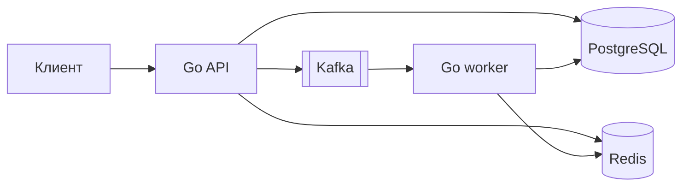

# DevOps Practice

Небольшое Go-приложение для последовательной практики GitLab, Docker,
Kubernetes и эксплуатации инфраструктурных сервисов. Бизнес-логика намеренно
ограничена: она только создаёт наблюдаемый поток через PostgreSQL, Redis и
Kafka.

## Быстрый старт

Требуются Docker Desktop либо Docker Engine с Compose, GNU Make и до 4 ГБ
свободной оперативной памяти для стенда.

```bash
cp .env.example .env
make up
make migrate
make smoke
```

После запуска API доступен на `http://localhost:8080`. Логи API и worker:

```bash
make logs
```

Остановить стенд без удаления данных:

```bash
make down
```

## Поток данных



PostgreSQL является источником истины. Redis хранит кеш заявок и производный
счётчик. Kafka доставляет событие `request.created` worker, который переводит
заявку из `created` в `processed`.

## HTTP API

| Метод | Путь | Назначение |
|---|---|---|
| `GET` | `/api/health-check` | Проверить PostgreSQL, Redis и Kafka |
| `POST` | `/api/requests` | Создать заявку и опубликовать событие |
| `GET` | `/api/requests/{id}` | Получить заявку через Redis/PostgreSQL |
| `GET` | `/api/stats` | Получить число обработанных заявок |

Пример создания заявки:

```bash
curl -sS -X POST http://localhost:8080/api/requests \
  -H 'Content-Type: application/json' \
  -d '{"title":"Подготовить релиз"}'
```

`/api/health-check` возвращает `200`, только если доступны все три зависимости.
При отказе одной из них возвращается `503` без строки подключения и внутренней
ошибки драйвера.

## Команды

| Команда | Результат |
|---|---|
| `make up` | Собрать образ и поднять полный стенд |
| `make migrate` | Идемпотентно применить SQL-миграции |
| `make smoke` | Проверить полный поток и graceful shutdown |
| `make ps` | Показать состояние контейнеров |
| `make logs` | Читать логи API и worker |
| `make down` | Остановить стенд, сохранив volumes |

## Конфигурация

Локальные значения копируются из `.env.example` в игнорируемый Git-файл
`.env`. Настоящие пароли и токены в репозиторий добавлять нельзя.

| Переменная | Назначение | Значение для стенда |
|---|---|---|
| `POSTGRES_USER` | Пользователь PostgreSQL | `devops` |
| `POSTGRES_PASSWORD` | Локальный пароль PostgreSQL | `devops_local_only` |
| `POSTGRES_DB` | База приложения | `devops_practice` |
| `API_PORT` | Порт API на компьютере | `8080` |
| `KAFKA_TOPIC` | Topic событий заявок | `requests.created.v1` |
| `KAFKA_GROUP` | Consumer group worker | `request-worker-v1` |
| `CACHE_TTL` | Срок хранения заявки в Redis | `30s` |
| `REQUEST_TIMEOUT` | Лимит обращения к одной зависимости | `2s` |
| `SHUTDOWN_TIMEOUT` | Лимит штатной остановки API | `10s` |

## Стартовые состояния модулей

Задания:

- [Модуль 00: запустить приложение](docs/modules/00-start.md)
- [Модуль 01: организовать безопасную поставку через GitLab](docs/modules/01-gitlab-ci.md)

Вспомогательный компонент Telegram-уведомлений описан в
[документации notifier](docs/notifier.md).

Опубликованная практика ссылается на неизменяемый тег `module-NN-start`.
Например, начать восьмой модуль независимо от предыдущих можно так:

```bash
git switch --detach module-08-start
git switch -c practice/08-kubernetes
```

В стартовом теге находятся выполненные предпосылки, но отсутствует решение
самого задания. Закрытые решения ментора не входят в историю этого репозитория.
