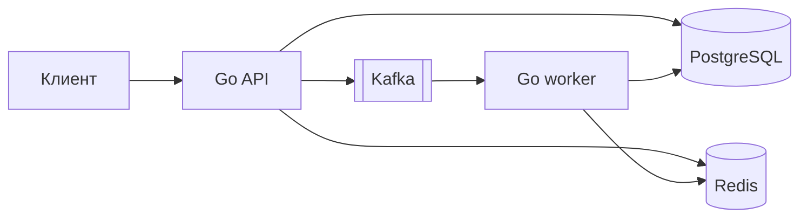

# DevOps Practice

Практика наблюдаемости: [модуль 04](../docs/modules/04-observability.md),
[установка и расследование инцидентов](../docs/runbooks/observability.md).

Эксплуатация PostgreSQL: [модуль 05](../docs/modules/05-postgresql.md),
[backup и диагностика](../docs/runbooks/postgresql-operations.md),
[Patroni и репликация](../docs/runbooks/patroni.md).

Kafka в контейнере: [модуль 06](../docs/modules/06-kafka.md) — topics,
consumer groups, offsets, lag и сроки хранения. Практику можно выполнить
отдельно, без запуска приложения и Kubernetes.

Ansible на двух Linux VM: [модуль 07](../docs/modules/07-ansible.md),
[подготовка VM и control node](../docs/runbooks/07-ansible-bootstrap.md).
Готовое приложение выдаётся, inventory/roles и сопровождение пишет ученик.

Terraform в Yandex Cloud: [модуль 08](../docs/modules/08-terraform-yandex-cloud.md),
[bootstrap и готовая установка](../docs/runbooks/08-terraform-bootstrap.md).
Одна VPC, две VM, GitLab state и ограничение исходящего доступа; Hard-практика
может выполняться отдельно. Облачный стенд платный, с бюджетом до 500 ₽.

Небольшое Go-приложение для последовательной практики GitLab, Docker,
Kubernetes и эксплуатации инфраструктурных сервисов. Бизнес-логика намеренно
ограничена: она только создаёт наблюдаемый поток через PostgreSQL, Redis и
Kafka.

## Быстрый старт

Требуются Docker Desktop либо Docker Engine с Compose, GNU Make и до 4 ГБ
свободной оперативной памяти для стенда.

```bash
cp .env.example .env
make up
make migrate
make smoke
```

После запуска API доступен на `http://localhost:8080`. Логи API и worker:

```bash
make logs
```

Остановить стенд без удаления данных:

```bash
make down
```

Для отдельной практики Kafka вместо полного стенда:

```bash
docker compose -p devops-practice-kafka-06 -f deploy/kafka-lab/compose.yaml \
  up -d --wait --wait-timeout 180
```

Подготовка терминалов и последовательность CLI-опытов описаны в
[модуле 06](../docs/modules/06-kafka.md).

## Поток данных



PostgreSQL является источником истины. Redis хранит кеш заявок и производный
счётчик. Kafka доставляет событие `request.created` worker, который переводит
заявку из `created` в `processed`.

## HTTP API

| Метод | Путь | Назначение |
|---|---|---|
| `GET` | `/livez` | Проверить, что процесс API отвечает |
| `GET` | `/readyz` | Проверить готовность PostgreSQL, Redis и Kafka |
| `GET` | `/api/health-check` | Проверить PostgreSQL, Redis и Kafka |
| `POST` | `/api/requests` | Создать заявку и опубликовать событие |
| `GET` | `/api/requests/{id}` | Получить заявку через Redis/PostgreSQL |
| `GET` | `/api/stats` | Получить число обработанных заявок |

Пример создания заявки:

```bash
curl -sS -X POST http://localhost:8080/api/requests \
  -H 'Content-Type: application/json' \
  -d '{"title":"Подготовить релиз"}'
```

`/api/health-check` возвращает `200`, только если доступны все три зависимости.
При отказе одной из них возвращается `503` без строки подключения и внутренней
ошибки драйвера. `/readyz` использует тот же dependency check для Kubernetes,
а `/livez` проверяет только HTTP-процесс и не вызывает внешние сервисы.

## Команды

| Команда | Результат |
|---|---|
| `make up` | Собрать образ и поднять полный стенд |
| `make migrate` | Идемпотентно применить SQL-миграции |
| `make smoke` | Проверить полный поток и graceful shutdown |
| `make ps` | Показать состояние контейнеров |
| `make logs` | Читать логи API и worker |
| `make down` | Остановить стенд, сохранив volumes |
| `make helm-check` | Проверить Helm chart через Helm, kubeconform и kube-linter |
| `make ci-local` | Выполнить локальные проверки кода, Compose и Helm chart |

Для `make helm-check` нужны `helm 4.3.0`, `kubeconform 0.8.0` и
`kube-linter 0.8.3` в `PATH`. Локальная Kubernetes-платформа использует
`k3d 5.8.3` и `kubectl 1.35.8`; закреплённые версии находятся в
[`deploy/platform/versions.env`](../deploy/platform/versions.env).

## Kubernetes

Инфраструктурные charts устанавливаются вручную по
[`docs/runbooks/kubernetes-platform.md`](../docs/runbooks/kubernetes-platform.md).
GitLab Runner с Kubernetes executor настраивается по
[`docs/runbooks/gitlab-runner-kubernetes.md`](../docs/runbooks/gitlab-runner-kubernetes.md).
GitLab CI валидирует код, собирает и сканирует image, публикует его и создаёт
promotion MR. Git хранит desired state, а Argo CD выполняет deployment и
reconciliation. Job `verify-development` только подтверждает фактический
результат и после успеха регистрирует GitLab deployment. Инфраструктура и
runtime Secret остаются manual bootstrap-объектами. Полный flow описан в
[`docs/runbooks/argocd-gitops.md`](../docs/runbooks/argocd-gitops.md).

## Конфигурация

Локальные значения копируются из `.env.example` в игнорируемый Git-файл
`.env`. Настоящие пароли и токены в репозиторий добавлять нельзя.

| Переменная | Назначение | Значение для стенда |
|---|---|---|
| `POSTGRES_USER` | Пользователь PostgreSQL | `devops` |
| `POSTGRES_PASSWORD` | Локальный пароль PostgreSQL | `devops_local_only` |
| `POSTGRES_DB` | База приложения | `devops_practice` |
| `API_PORT` | Порт API на компьютере | `8080` |
| `KAFKA_TOPIC` | Topic событий заявок | `requests.created.v1` |
| `KAFKA_GROUP` | Consumer group worker | `request-worker-v1` |
| `CACHE_TTL` | Срок хранения заявки в Redis | `30s` |
| `REQUEST_TIMEOUT` | Лимит обращения к одной зависимости | `2s` |
| `PG_POOL_MAX_CONNS` / `PG_POOL_MIN_CONNS` | Максимум / минимум соединений каждого процесса | `5` / `1` |
| `PG_STATEMENT_TIMEOUT` | Лимит выполнения SQL | `1s` |
| `PG_LOCK_TIMEOUT` | Лимит ожидания блокировки | `500ms` |
| `PG_IDLE_IN_TRANSACTION_TIMEOUT` | Лимит простоя открытой транзакции | `5s` |
| `SHUTDOWN_TIMEOUT` | Лимит штатной остановки API/worker | `10s` |
| `METRICS_ADDR` | Отдельный listener метрик API и worker | `:9090` |

## Стартовые состояния модулей

Задания:

- [Модуль 00: запустить приложение](../docs/modules/00-start.md)
- [Модуль 01: организовать безопасную поставку через GitLab](../docs/modules/01-gitlab-ci.md)
- [Модуль 02: развернуть приложение в Kubernetes](../docs/modules/02-kubernetes-helm.md)
- [Модуль 03: перевести поставку на GitOps с Argo CD](../docs/modules/03-gitops-argocd.md)
- [Модуль 04: настроить наблюдаемость и расследовать инциденты](../docs/modules/04-observability.md)
- [Модуль 05: эксплуатировать PostgreSQL и кластер Patroni](../docs/modules/05-postgresql.md)
- [Модуль 06: исследовать Kafka, consumer groups и retention](../docs/modules/06-kafka.md)
- [Модуль 07: управлять двумя Linux VM через Ansible](../docs/modules/07-ansible.md)

Вспомогательный компонент Telegram-уведомлений описан в
[документации notifier](../docs/notifier.md).

Опубликованная практика ссылается на неизменяемый тег `module-NN-start`.
После публикации соответствующего тега начать Ansible независимо от предыдущих можно так:

```bash
git switch --detach module-07-start
git switch -c practice/07-ansible
```

В стартовом теге находятся выполненные предпосылки, но отсутствует решение
самого задания. При подготовке `module-07-start` референс ментора исключается
из его tree; доступ к другим refs публичного репозитория не ограничивает
просмотр решений. Пока тег не опубликован, используйте выданный ментором checkout.
